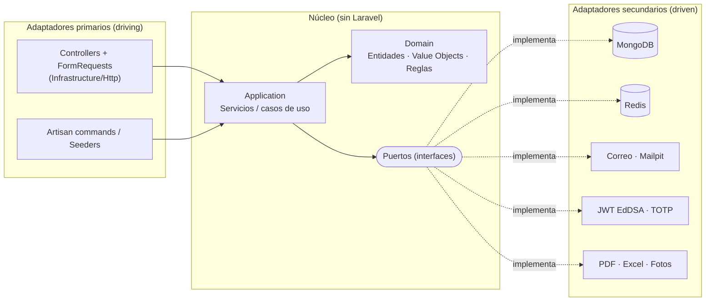
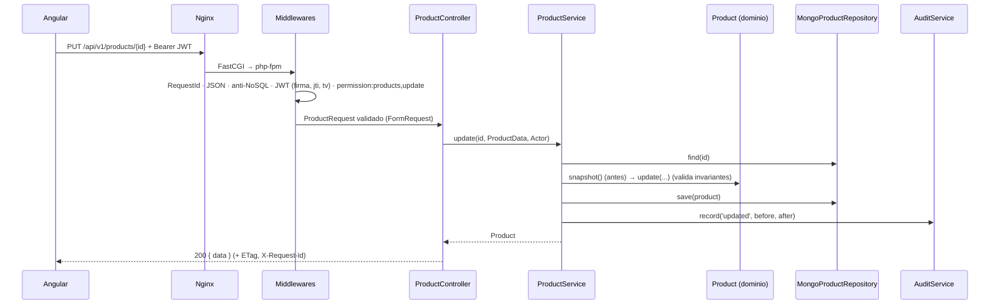
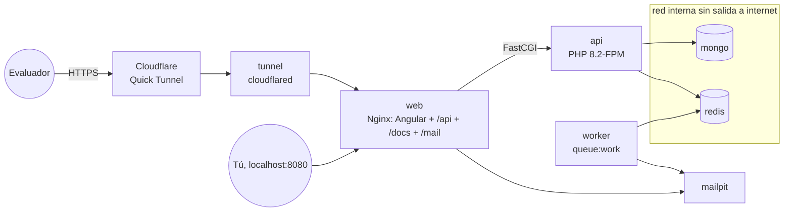
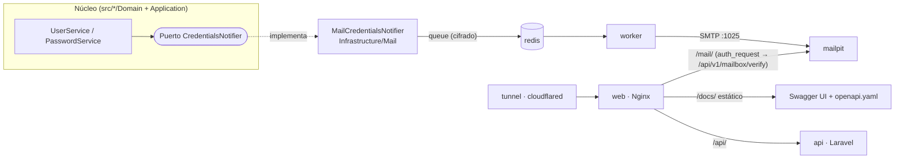

# Arquitectura

## 1. Decisión: Hexagonal (Ports & Adapters) organizada por contextos

**Pregunta típica:** *¿Clean Architecture o Hexagonal?*

Ambas siguen la **misma regla de dependencias**: el negocio no depende de frameworks ni de la base de
datos; las dependencias apuntan hacia adentro. La diferencia es de vocabulario y de cuántos anillos
dibujas. Para este proyecto elegí **Hexagonal** porque:

1. **El examen permite 3 bases NoSQL** (MongoDB, Firestore o DynamoDB). Con *puertos* (`ProductRepository`,
   `UserRepository`…) cambiar de base es escribir **un adaptador nuevo** y cambiar **una línea** en
   `HexagonalServiceProvider`. El dominio y los casos de uso no se tocan.
2. **Mapea 1:1 con Laravel**: los controladores son *adaptadores primarios* (entrada); Mongo, Redis,
   correo, JWT y PDF son *adaptadores secundarios* (salida).
3. **Pruebas sin infraestructura**: `ProductServiceTest` prueba alta/edición/bitácora/exportación con
   dobles en memoria — sin MongoDB, Redis ni HTTP — en milisegundos.
4. **Escala sin reescribir**: cada contexto (`Catalog`, `IdentityAccess`, `Audit`, `Reporting`) es un
   módulo autocontenido; mañana puede separarse en un microservicio (los JWT EdDSA se validan solo con la
   llave pública).

En corto: *es Clean Architecture aplicada con el vocabulario de puertos y adaptadores, partida en
contextos de negocio (DDD táctico ligero).*



## 2. Capas y regla de dependencias (backend)

```
backend/src/<Contexto>/
├── Domain/           Entidades, Value Objects, interfaces de repositorio, excepciones de negocio.
│                     No importa NADA de Laravel ni de MongoDB.
├── Application/      Casos de uso (servicios) y puertos (Clock, QueryCache, TokenService…).
│                     Orquesta dominio + puertos. No sabe de HTTP.
└── Infrastructure/   Adaptadores: Persistence (Mongo), Http (controllers/requests/presenters),
                      Security (JWT, TOTP, Argon2id), Mail, Storage, Console.
```

| Contexto | Responsabilidad |
|---|---|
| `Shared` | Kernel común: `Email`, `EntityCode`, paginación, puertos transversales (reloj, caché, bitácora, exportador), middlewares HTTP |
| `Catalog` | Productos |
| `IdentityAccess` | Usuarios, perfiles (secciones/acciones), autenticación, 2FA, sesiones |
| `Audit` | Bitácora (implementa el puerto `AuditTrail` que usan los demás) |
| `Reporting` | Read model del tablero de inicio |

El **composition root** (único lugar que conoce puertos *y* adaptadores) es
`backend/app/Providers/HexagonalServiceProvider.php`.

## 3. Flujo de una petición

`PUT /api/v1/products/{id}`:



## 4. Modelo de datos (MongoDB)

| Colección | Documento (resumen) | Índices | Notas NoSQL |
|---|---|---|---|
| `products` | `code, name, brand, price(Decimal128), search, created_at, updated_at` | `code` único, `created_at`, `name`, `price`, `brand` | Precio exacto con **Decimal128** (no float) |
| `users` | `code, name, email, phone, photo_path, profile_ids[ObjectId], security{…}, two_factor{…}` | `email` único, `code` único, `profile_ids` (multikey) | **Referencias** a perfiles (se comparten) + subdocumentos **embebidos** de seguridad |
| `profiles` | `code, name, name_key, description, sections[{section, actions[]}]` | `code` único, `name_key` único | Secciones **embebidas**: se leen siempre con el perfil |
| `audit_logs` | `event, entity_type, entity_id, actor{…}, before{}, after{}, changes[], ip, created_at` | `created_at`, `(entity_type, entity_id, created_at)`, `event` | Esquema flexible: snapshots de entidades distintas en una sola colección |
| `refresh_tokens` | `user_id, family_id, token_hash, expires_at, revoked_at, replaced_by` | `token_hash` único, **TTL** en `expires_at` | Mongo borra solos los vencidos |
| `counters` | `{_id: 'products', seq: 38}` | — | `$inc` atómico → códigos consecutivos sin colisiones |

- **Validación de esquema** (`$jsonSchema`, `validationLevel: strict`) en la migración
  `database/migrations/2026_11_25_000001_create_mongo_collections.php`: Mongo rechaza documentos mal
  formados aunque alguien escriba directo a la BD.
- **Usuario de mínimo privilegio**: la API se conecta como `tap_app` (`readWrite` + `dbAdmin` solo sobre
  la BD `tap`), nunca como root (`docker/mongo/init-app-user.js`).
- **Búsqueda**: campo `search` normalizado (minúsculas, sin acentos) + regex **escapada**.
  Para millones de registros: índice de texto o Atlas Search (cambio solo en el adaptador).

## 5. Rendimiento y caché

| Capa | Técnica | Dónde |
|---|---|---|
| Lecturas | **Caché versionada en Redis**: cada namespace (`products`, `users`…) tiene un número de versión en la llave; escribir sube la versión → invalidación O(1) sin escanear Redis | `Shared/Infrastructure/Cache/VersionedQueryCache.php` |
| Autenticación | Usuario + permisos cacheados 5 min (no se consulta Mongo en cada petición); se invalida al cambiar usuarios/perfiles | `AuthUserProvider.php` |
| HTTP | **ETag** + `Cache-Control: private, no-cache` → 304 sin cuerpo si no cambió | `HttpCacheHeaders.php` |
| Estáticos | Archivos con hash: `max-age=1 año, immutable`; `index.html` sin caché; gzip | `docker/nginx/default.conf` |
| PHP | OPcache + **JIT**, autoloader *classmap-authoritative*, `config/route/view/event:cache` | `docker/php/conf.d/app.ini`, entrypoint |
| Mongo | Proyecciones (no se traen hashes ni snapshots en listados), `estimatedDocumentCount` sin filtros, cursores con `batchSize` para exportar | repositorios Mongo |
| Exportación | Excel en **streaming** (OpenSpout, memoria constante); PDF con subconjunto de fuentes (~30 KB) | `TabularFileExporter.php` |
| Frontend | Lazy loading por ruta, `OnPush` + signals, búsqueda con `debounceTime(300)` + `switchMap` (cancela peticiones viejas), caché en memoria de catálogos, esqueletos de carga | `shared/utils/list-controller.ts` |
| Colas | Correos en cola Redis (worker separado): la petición HTTP no espera al SMTP | servicio `worker` |

## 6. Frontend (Angular 19)

```
frontend/src/app/
├── core/       Singleton: auth (store con signals, servicio, guards), http (interceptores, descargas), ui (toasts, tema, diálogos)
├── shared/     Reutilizable: ui (tabla/paginador/buscador/modal/íconos), directivas (*appCan), pipes (appDate, phone), utils
├── layout/     Shell: barra lateral filtrada por permisos + barra superior
└── features/   Una carpeta por pantalla: *.api.ts (datos) · *.page.ts (pantalla) · *.dialog.ts (modales)
```

- **Standalone components**, **signals**, nuevo control flow (`@if/@for`), `input()/output()/model()`.
- **Interceptores funcionales**: `loading` → `auth` (Bearer + refresh de un solo vuelo) → `error` (toasts).
- **Token solo en memoria**; al recargar se restaura con la cookie HttpOnly (`provideAppInitializer`).
- **Transiciones**: View Transitions API entre páginas, `@angular/animations` en toasts, animaciones CSS
  en tablas/modales; todo se desactiva con `prefers-reduced-motion`.
- **Tailwind CSS v4** (configuración CSS-first en `src/styles.css`) + **Angular CDK** (diálogos
  accesibles, focus trap, breakpoints) + **Lucide** (íconos) + **libphonenumber-js** (teléfonos).

## 7. Infraestructura



- Un **solo origen** (Nginx sirve el frontend y hace de gateway a la API): sin CORS, cookies
  `SameSite=Strict` funcionando y una sola URL pública.
- `mongo` y `redis` viven en una red Docker `internal` (sin puertos expuestos ni salida a internet).
- El puerto 8080 se publica solo en `127.0.0.1`; hacia afuera solo existe el túnel HTTPS.

### 7.1 Túnel, Swagger y correos: ¿dónde viven?

Ninguna de las tres es parte del **núcleo hexagonal** (dominio + casos de uso). Son piezas de
**infraestructura de entrega y soporte** que rodean al hexágono:

| Pieza | Capa | Contenedor | Archivos | Cómo llega una petición |
|---|---|---|---|---|
| **Túnel público** | Infraestructura de red (fuera de la app) | `tunnel` (cloudflared) | `docker-compose.yml` (servicio `tunnel`), `scripts/public.sh`, `public-status.sh`, `unpublish.sh` | Internet → Cloudflare → `tunnel` → `web:80`. La app no sabe que existe: para Laravel es solo un *proxy de confianza* que manda `X-Forwarded-For/Proto` (ver `trustProxies` en `bootstrap/app.php`) |
| **Swagger UI** | Documentación del **adaptador primario HTTP** (describe los controladores) | `web` (Nginx, archivos estáticos) | `docs/openapi.yaml` (contrato), `docker/swagger/index.html` + `initializer.js`, `docker/nginx/Dockerfile` (copia swagger-ui-dist y el YAML a `/usr/share/nginx/docs/`), `location ^~ /docs/` en `docker/nginx/default.conf` | `/docs/` lo sirve Nginx directamente; PHP no interviene. El botón *Try it out* llama a `/api/v1/...` en el mismo origen |
| **Correos** | **Adaptador secundario** del puerto `CredentialsNotifier` | `api` (encola) → `redis` (cola) → `worker` (envía) → `mailpit` (recibe y muestra) | Puerto: `src/IdentityAccess/Application/Port/CredentialsNotifier.php` · Adaptador: `Infrastructure/Mail/MailCredentialsNotifier.php` + `CredentialsMail.php` · Plantilla: `resources/views/mail/credentials.blade.php` · Conexión: `MAIL_*` en `docker-compose.yml` · Ruta: `location ^~ /mail/` en Nginx | `UserService::create()` o `PasswordService::requestReset()` llaman al puerto → el adaptador encola el Mailable **cifrado** → el `worker` lo envía por SMTP a `mailpit:1025` → lo ves en `/mail/`. **Acceso:** Nginx hace `auth_request` a `GET /api/v1/mailbox/verify` (cookie firmada `tap_mail`); sin cookie redirige a `/correos` (pantalla Angular `features/mailbox/`), que la obtiene con `POST /api/v1/mailbox/session` (credenciales) o `/session/me` (sesión con `users:create`). Código: `src/Support/Infrastructure/Http/MailboxController.php` + `MailboxPass.php` |



**En producción** se cambia solo infraestructura: Mailpit → SMTP real o SES (variables `MAIL_*`, sin
tocar código; o un adaptador nuevo de `CredentialsNotifier`), Quick Tunnel → túnel con nombre y dominio
fijo, y Swagger puede quedarse o protegerse con autenticación en Nginx.

## 8. Decisiones registradas (ADR breves)

| # | Decisión | Alternativa | Motivo |
|---|---|---|---|
| 1 | MongoDB | Firestore / DynamoDB | Corre local en Docker, driver oficial para Laravel, transacciones/validación de esquema, TTL |
| 2 | JWT EdDSA propio (firebase/php-jwt) | `tymon/jwt-auth`, Sanctum | Control total: tipos de token, `jti`, `tv`, rotación de refresh; asimétrico |
| 3 | Refresh token opaco en cookie HttpOnly + access JWT en memoria | Todo en localStorage | Un XSS no puede robar la sesión persistente |
| 4 | Contraseña temporal en recuperación | Link de restablecimiento | El examen pide "enviar credenciales"; se hizo seguro (expira, no reemplaza la actual hasta usarse) |
| 5 | Repositorios con la librería MongoDB directa | Eloquent de laravel-mongodb | Uso explícito de Decimal128, proyecciones, `$inc`, TTL; mapeo a entidades de dominio puras |
| 6 | Servicios de aplicación por agregado | Un handler por caso de uso | Menos archivos para un mini proyecto; separar en handlers es mecánico si crece |
| 7 | Bitácora con snapshots completos | Event sourcing | Cumple "comparar anterior vs actual" con mucha menos complejidad |
| 8 | Tailwind + CDK | Angular Material / PrimeNG | Diseño propio con la identidad negro/amarillo, bundle pequeño, accesibilidad del CDK |
