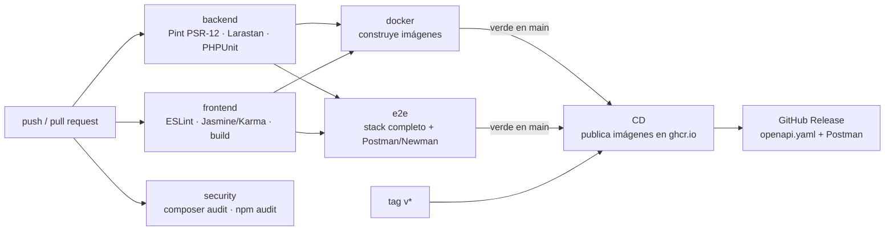

# CI/CD

Criterio del examen: **"Extras — Implementación de CI/CD, pruebas unitarias" (10 %)**.

## 1. Pipeline

| Workflow | Archivo | Cuándo | Qué hace |
|---|---|---|---|
| **CI** | `.github/workflows/ci.yml` | cada push y PR | 5 jobs: `backend`, `frontend`, `docker`, `e2e`, `security` |
| **CD** | `.github/workflows/cd.yml` | CI en verde sobre `main`, o tag `v*` | Imágenes `api` y `web` multi-arquitectura (amd64 + arm64) con SBOM y procedencia → `ghcr.io/<dueño>/tap-prueba-{api,web}`; con tag, crea el Release |

Detalles de calidad:
- Acciones **fijadas por SHA** (no por tag): evita ataques de cadena de suministro.
- `permissions` mínimos por workflow; `concurrency` cancela corridas viejas del mismo branch.
- Caché de dependencias (npm) y de capas Docker (GitHub Actions cache).
- El job `e2e` usa **los mismos scripts que en local** (`scripts/setup.sh` y `scripts/test-api.sh`).
- La CD solo publica si el CI pasó: nunca se publica una imagen sin pruebas.

## 2. Mismo pipeline en tu equipo (solo Docker)

| Comando | Sin `make` | Equivale a | Qué corre |
|---|---|---|---|
| `make test-back` | `./scripts/test-back.sh` | job `backend` | Pint (PSR-12) + Larastan nivel 6 + PHPUnit (unitarias + API contra MongoDB, BD aislada `tap_test`) |
| `make test-front` | `./scripts/test-front.sh` | job `frontend` | ESLint (angular-eslint) + Karma/Jasmine en Chromium headless + build de producción |
| `make test-api` | `./scripts/test-api.sh` | job `e2e` | Colección de Postman contra el sistema levantado (Newman); reporte JUnit en `reports/newman.xml` |
| `make test` | los tres scripts | — | Todas las pruebas |
| `make ci` | — | CI completo | Construye imágenes, levanta el stack y corre los tres anteriores |

Ninguno requiere instalar PHP, Composer, Node ni MongoDB: todo corre en contenedores con versiones
fijas (`php:8.2.36-fpm-alpine3.23`, `node:22.23.5-alpine3.23`, `postman/newman:6.1.3-alpine`).
Los scripts nunca reciben contraseñas como argumentos (no aparecen en `ps` ni en los logs del CI).

## 3. Pruebas

| Capa | Herramienta | Dónde | Qué cubren |
|---|---|---|---|
| Dominio y casos de uso (backend) | PHPUnit | `backend/tests/Unit` | Reglas de precio, correo (CRLF), códigos, permisos por perfil, bloqueo de cuenta, contraseña temporal, JWT (firma, `alg:none`, expiración, tipo), bitácora (diferencias), anti-inyección NoSQL. `ProductServiceTest` corre **sin base de datos** (adaptadores en memoria) |
| API HTTP (backend) | PHPUnit + MongoDB real | `backend/tests/Feature` | Login, bloqueo, logout/revocación, refresh con rotación y detección de reúso, recuperación de contraseña, CRUD, validaciones del examen, permisos 403, exportación PDF/Excel, alta de usuario con foto |
| Frontend | Jasmine/Karma | `frontend/src/**/*.spec.ts` | Store de sesión y `AuthService` (login, 2FA, un solo refresh con cabecera anti-CSRF, logout), guards por perfil, `*appCan`, interceptores (Bearer, refresh, errores), `ListController` de las tablas (debounce, orden, filtros, errores), validadores, pipes de fecha/teléfono, paginador, notificaciones y bloqueo de redirecciones abiertas en la bandeja |
| Contrato de la API (extremo a extremo) | Postman + Newman | `docs/postman/` | 44 peticiones con 87 aserciones: código HTTP de cada endpoint, formato paginado, archivos PDF/Excel, bitácora antes/después, y casos negativos del examen (precio de 4 dígitos, alta sin foto, correo y perfil duplicados → 409, teléfono sin código de país, sin token → 401, registro eliminado → 404, inyección NoSQL → 400) |

## 4. Activarlo en GitHub
1. Crear el repositorio y subir la rama (requiere autorización del dueño del repo).
2. Las acciones corren solas; las imágenes quedan en *Packages* del perfil/organización.
3. Para un release: `git tag v1.0.0 && git push --tags`.
